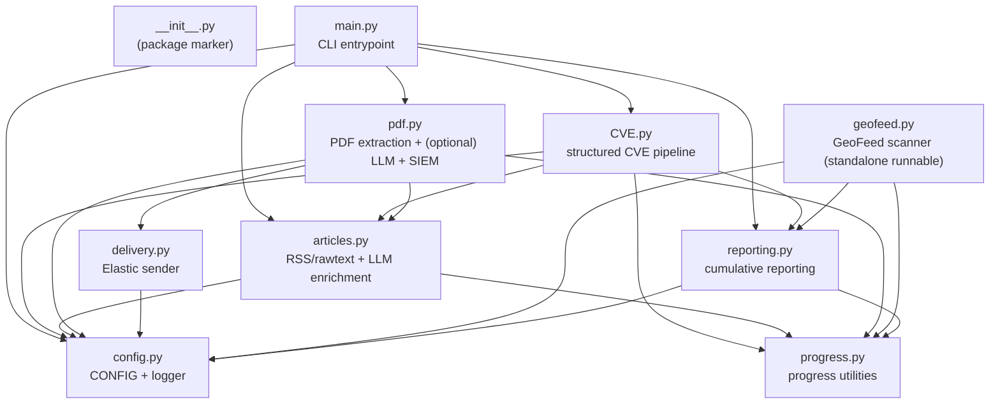

# Collector diagrams

---

## Architecture overview

```mermaid
flowchart TB

  %% =========================
  %% Entry / Orchestration
  %% =========================
  subgraph ENTRY["Entry Point"]
    MAIN["main.py\nCLI flags + interactive menu\nDispatches pipelines"]
  end

  %% =========================
  %% Shared Runtime
  %% =========================
  subgraph SHARED["Shared Runtime / Cross-cutting"]
    CONFIG["config.py\nCONFIG (env-driven)\npaths + feature flags\nlogger + fetch_json()"]
    PROGRESS["progress.py\nprogress_bar()\nstart_live_progress()/stop_live_progress()"]
  end

  %% =========================
  %% Pipelines
  %% =========================
  subgraph PIPE["Collector Pipelines"]
    CVE["CVE.py\nrun_structured_collection(hours)\nNVD + KEV → normalize → vendor match\n(optional) LLM refine → Markdown"]
    ARTICLES["articles.py\nrun_fetch(hours) / run_fetch_rawtext(hours)\nRSS → article text → rawtext JSON\nrun_llm_rawtext(hours)\nrawtext → LLM → NDJSON + Markdown"]
    PDF["pdf.py\nrun_pdf_analysis(path, hours?)\nextract text (pypdf/pdftotext)\n(optional) LLM analyze → NDJSON + Markdown\n(optional) SIEM delivery"]
    GEO["geofeed.py\n(run as module + CLI entry)\nGeoFeed local-news scanning\n(optional) compare vs prior snapshots\n(optional) LLM summarization\n→ Markdown (+ optional notifications)"]
    REPORT["reporting.py\nrun_reporting(period_days)\ncollect prior LLM/NDJSON outputs\nLLM cumulative report → Markdown"]
  end

  %% =========================
  %% External Inputs / Services
  %% =========================
  subgraph EXT["External Inputs / Services"]
    NVD["NVD CVE API\n(TI_NVD_API_BASE)"]
    KEV["CISA KEV JSON\n+ community KEV URL(s)"]
    RSS["RSS feeds\n(TI_RSS_FEEDS)"]
    FILES["Local files\n(PDFs etc.)"]
    OLLAMA["Ollama HTTP API\n(TI_OLLAMA_HOST / TI_LLM_MODEL)\nLLM_ENABLED gate"]
    ELASTIC["Elastic endpoint\n(TI_ELASTIC_*)\nSIEM_ENABLED gate"]
  end

  %% =========================
  %% Outputs / Artifacts
  %% =========================
  subgraph OUT["Outputs on Disk (results/)"]
    OUT_CVE["results/cve/<day>/<run>/\nJSON + Markdown"]
    OUT_ART["results/articles/<day>/<run>/\nrawtext JSON"]
    OUT_LLMRAW["results/llmrawtext/<day>/<run>/\nNDJSON + Markdown"]
    OUT_PDF["results/pdf/<day>/<run>/\nNDJSON + Markdown"]
    OUT_REP["results/reporting/<day>/<run>/\nMarkdown"]
  end

  %% Orchestration to pipelines
  MAIN --> CVE
  MAIN --> ARTICLES
  MAIN --> PDF
  MAIN --> GEO
  MAIN --> REPORT

  %% Shared dependencies
  MAIN --> CONFIG
  CVE --> CONFIG
  ARTICLES --> CONFIG
  PDF --> CONFIG
  GEO --> CONFIG
  REPORT --> CONFIG

  CVE --> PROGRESS
  ARTICLES --> PROGRESS
  PDF --> PROGRESS
  GEO --> PROGRESS
  REPORT --> PROGRESS

  %% External interactions
  CVE --> NVD
  CVE --> KEV
  ARTICLES --> RSS
  GEO --> RSS
  PDF --> FILES

  %% Optional LLM usage (feature-flagged in config)
  CVE -. "LLM_ENABLED" .-> OLLAMA
  ARTICLES -. "LLM_ENABLED" .-> OLLAMA
  GEO -. "GEOFEED_USE_OLLAMA / LLM_ENABLED" .-> OLLAMA
  REPORT -. "LLM_ENABLED" .-> OLLAMA
  PDF -. "LLM (if enabled in pdf flow)" .-> OLLAMA

  %% Outputs
  CVE --> OUT_CVE
  ARTICLES --> OUT_ART
  ARTICLES --> OUT_LLMRAW
  PDF --> OUT_PDF
  REPORT --> OUT_REP

  %% Delivery
  PDF -. "SIEM_ENABLED & SIEM_TYPE=elastic" .-> ELASTIC
```



## Runtime process flow

```mermaid
flowchart TB

  START([Start]) --> PARSE["main.py\nParse args:\n--cve / --articles / --unstructured-pdf PATH\n--geofeed / --geofeed-compare (latest|2d|7d)\n--reporting (2|7|14|30)\n--tests / --hours / --no-history / --no-banner"]

  PARSE --> MODE{Any pipeline flags?}

  MODE -- "No" --> LOOP["Interactive loop:\n- prompt hours\n- menu command\n- optional history behavior"]
  LOOP --> DISPATCH["Dispatch chosen command"]

  MODE -- "Yes" --> DISPATCH

  %% -------------------------
  %% Structured CVE path
  %% -------------------------
  DISPATCH -->|--cve or menu 'cve'| CVE1["CVE.py\nrun_structured_collection(hours)"]
  CVE1 --> CVE2["Fetch KEV sources\nfetch_kev_sources()"]
  CVE2 --> CVE3["Fetch NVD window\nfetch_nvd_window()"]
  CVE3 --> CVE4["Normalize + extract\nnormalize_cve()\nextract_description()/extract_cvss()"]
  CVE4 --> CVE5["Vendor matching\nbuild_vendor_patterns()\nmatch_vendor()/scan_text_fields_for_vendor()"]
  CVE5 --> CVE6{LLM_ENABLED?}
  CVE6 -- Yes --> CVE7["_llm_refine_cve() via Ollama\n(timeout controlled by config)"]
  CVE6 -- No --> CVE8["Skip LLM refinement"]
  CVE7 --> CVE9["generate_markdown()\nWrite results/cve/<day>/<run>/"]
  CVE8 --> CVE9

  %% -------------------------
  %% Articles path
  %% -------------------------
  DISPATCH -->|--articles or menu 'articles'| A0["articles.py\nrun_fetch(hours)\n(then) run_llm_rawtext(hours)"]
  A0 --> A1["Fetch RSS feeds\nThreadPool fetching\nHTTP retry/backoff\nfetch_article_text()"]
  A1 --> A2["Extract text + IOCs\nhtml_to_main_text()\nextract_iocs()"]
  A2 --> A3["Write rawtext JSON\nresults/articles/<day>/<run>/"]
  A3 --> A4{LLM_ENABLED?}
  A4 -- Yes --> A5["LLM enrichment\n_call_llm() + _enrich_record_with_llm()\nWrite NDJSON + MD\nresults/llmrawtext/<day>/<run>/"]
  A4 -- No --> A6["Stop after rawtext"]

  %% -------------------------
  %% PDF path
  %% -------------------------
  DISPATCH -->|--unstructured-pdf PATH or menu 'pdf'| P1["pdf.py\nrun_pdf_analysis(path)"]
  P1 --> P2["Extract text\nextract_text_from_pdf()\n(pypdf) + (pdftotext if available)"]
  P2 --> P3{LLM_ENABLED?\n(pdf flow uses LLM analyzer when enabled)}
  P3 -- Yes --> P4["_pdf_llm_analyze()\n_normalize_pdf_llm()\nWrite NDJSON + MD\nresults/pdf/<day>/<run>/"]
  P3 -- No --> P5["Write minimal NDJSON/MD (no LLM)\nresults/pdf/<day>/<run>/"]
  P4 --> P6{SIEM_ENABLED & elastic?}
  P5 --> P6
  P6 -- Yes --> P7["delivery.py\nsend_batch_to_elastic()\n(bulk/ndjson with retries)\n(respects SIEM_DRY_RUN)"]
  P6 -- No --> DONE([Done])

  %% -------------------------
  %% GeoFeed path
  %% -------------------------
  DISPATCH -->|--geofeed / menu 'geofeed'| G1["geofeed.py\nGeoFeed scanner\n(optional compare: latest|2d|7d)"]
  G1 --> G2["Fetch & score items\nfilters + dedupe\nsalient lookback window"]
  G2 --> G3{Use Ollama?}
  G3 -- Yes --> G4["Summaries / classifications\nvia Ollama (if enabled)"]
  G3 -- No --> G5["Rule-based summaries only"]
  G4 --> G6["Write GeoFeed Markdown\n(results path governed by config)"]
  G5 --> G6

  %% -------------------------
  %% Reporting path
  %% -------------------------
  DISPATCH -->|--reporting N or menu 'reporting'| R1["reporting.py\nrun_reporting(period_days=N)\n(N in {2,7,14,30})"]
  R1 --> R2["Collect prior outputs\n_parse_ndjson() / _collect_llm_records()"]
  R2 --> R3{LLM_ENABLED?}
  R3 -- Yes --> R4["LLM cumulative report\nWrite results/reporting/<day>/<run>/"]
  R3 -- No --> R5["Stops or produces limited report (no LLM)"]

  %% -------------------------
  %% Tests path
  %% -------------------------
  DISPATCH -->|--tests| T1["Run pytest\npython -m pytest -q tests"]
  T1 --> DONE
  CVE9 --> DONE
  A5 --> DONE
  A6 --> DONE
  P7 --> DONE
  G6 --> DONE
  R4 --> DONE
  R5 --> DONE

```

---

## Module dependency graph

